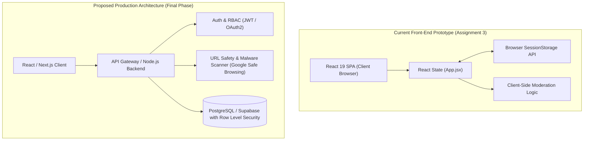
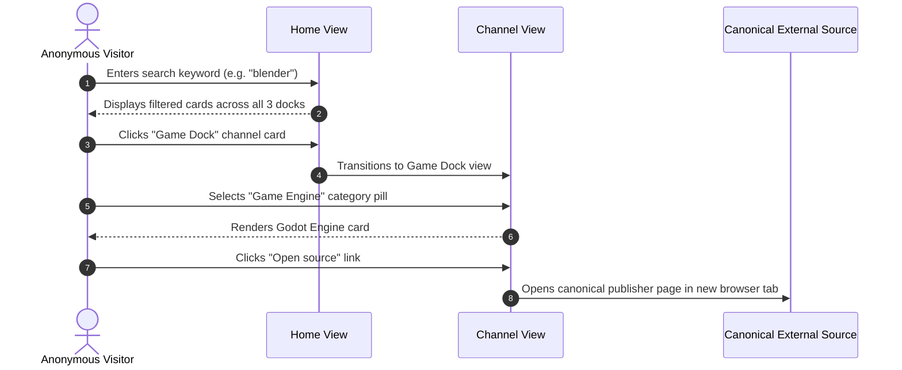
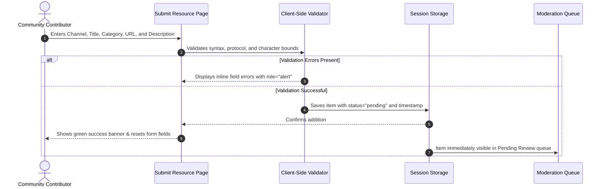
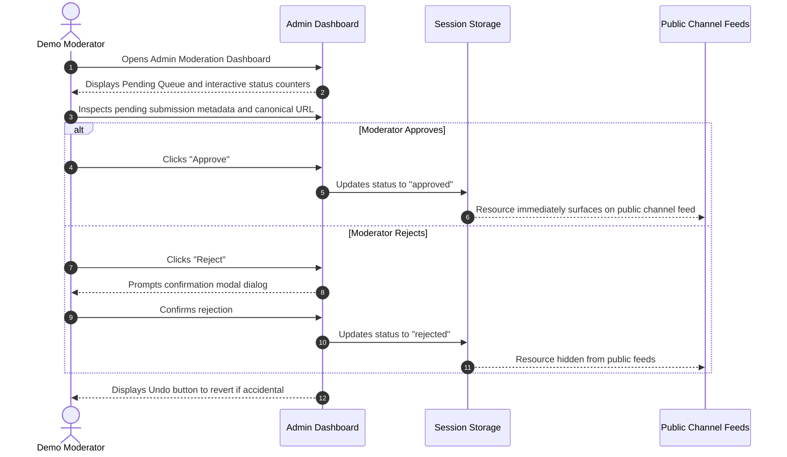

# Digital Dock — Architecture & User Journey Specification

**Document Version:** 1.0.0  
**Context:** Academic Assignment 3 (Prototype Implementation) & Production Architecture Plan

---

## 1. Prototype Architecture vs. Future Production Target



### 1.1 Current Prototype Scope (Implemented)
- **Runtime:** Client-side Single Page Application (Vite + React 19).
- **Data Persistence:** Stored locally in the user's browser `sessionStorage`. Data persists across page reloads within the same session, with an instant "Reset Demo Data" option.
- **Moderation Workflow:** Real-time in-memory status transitions (`pending` -> `approved` / `rejected`).
- **Security Posture:** Honest client-side demonstration. No hidden fake security boundaries; demo notices clearly inform evaluators that authentication is not connected.

### 1.2 Proposed Production Scope (Roadmap)
- **Database:** Relational store (PostgreSQL) tracking resources, submission metadata, audit trails, and moderation history.
- **Authentication:** Role-Based Access Control (RBAC) separating anonymous visitors, authenticated submitters, and verified staff moderators.
- **Automated Ingestion Pipeline:** Asynchronous URL validation using server-side HEAD requests, DNS verification, and threat intelligence APIs before surfacing to human moderators.

---

## 2. End-to-End User Journeys

### 2.1 Journey A: Visitor Resource Discovery


1. **Entry:** Visitor lands on Home, greeted by the hero banner and search bar.
2. **Global Search:** Types a term; cards update instantly across all docks.
3. **Channel Deep-Dive:** Navigates via sidebar or channel cards into Movie Dock, Study Dock, or Game Dock.
4. **Faceted Filtering:** Filters by category pills (e.g., *Documentation*, *Interactive Learning*, *Animation*).
5. **Outbound Navigation:** Clicks "Open source" to view the original material on the publisher's official website.

---

### 2.2 Journey B: Community Resource Submission


1. **Initiation:** User clicks "Submit resource" in sidebar or "+ Submit to [Channel]" on a channel page.
2. **Input & Validation:** Form checks that URL uses `http:` or `https:`, title is between 2–100 chars, description is between 10–500 chars, and category is defined.
3. **Submission:** Upon submitting, item receives a unique timestamp ID and status `'pending'`.
4. **Feedback:** A success banner informs the user that the resource has entered the moderation queue.

---

### 2.3 Journey C: Admin Moderation & Quality Control


1. **Queue Inspection:** Reviewer views count of pending, approved, and rejected submissions.
2. **Review:** Reviewer inspects source domain, description, and link validity.
3. **Decision:** 
   - **Approve:** Item status updates to `'approved'`; it immediately appears in the corresponding channel.
   - **Reject:** Confirmation modal protects against accidental clicks; upon confirmation, item status updates to `'rejected'`.
4. **Undo Protection:** An action banner with an "Undo" button allows restoring the previous status instantly.

---

## 3. Data Structures & Schema Definition

### 3.1 Resource Record Model
```typescript
interface ResourceItem {
  id: number | string;           // Unique timestamp or sequential identifier
  title: string;                 // 2 - 100 characters
  channel: 'Movie Dock' | 'Study Dock' | 'Game Dock';
  category: string;              // 2 - 40 characters (e.g. 'Documentation', 'Animation')
  desc: string;                  // 10 - 500 characters
  url: string;                   // Validated http:// or https:// canonical URL
  domain: string;                // Normalized hostname (e.g. 'developer.mozilla.org')
  status: 'pending' | 'approved' | 'rejected';
  submittedAt: string;           // ISO 8601 timestamp string
  moderationNote?: string;       // Optional review comment
}
```

---

## 4. Security Boundaries & Threat Model

| Boundary | Prototype Implementation | Production Migration Requirement |
| :--- | :--- | :--- |
| **URL Schemes** | Restricted to `http:` and `https:` in JavaScript; rejects `javascript:`, `data:`, `file:`. | Enforced at API layer; rejects private IP ranges (`10.0.0.0/8`, `127.0.0.1`, RFC 1918) to prevent Server-Side Request Forgery (SSRF). |
| **Authentication** | Demo only; clearly labeled as unauthenticated demo screen. | Strong authentication (OAuth 2.0 / Argon2 password hashing) with Role-Based Access Control. |
| **Data Integrity** | Saved in browser `sessionStorage`; safe from cross-tab collision. | PostgreSQL database with transactions and audit logging. |
| **Outbound Links** | `rel="noopener noreferrer"`, `target="_blank"`, with screen-reader text. | Content Security Policy (`default-src 'self'`), referrer-policy strict-origin. |
| **Abuse & Spam** | Client-side character validation and rate limits. | Cloudflare Turnstile / reCAPTCHA v3 and IP-based rate limiting. |

---

## 5. User Feedback Evaluation: "Multi-OS Smart Switching"

During user evaluation (Google Form feedback), one respondent proposed the addition of **"Multi-OS Smart Switching"**. An architectural review was conducted:

### 5.1 Architectural Inspection & Ambiguities
1. **Current Directory Model:** Digital Dock indexes canonical URLs (e.g., `https://godotengine.org/`, `https://developer.mozilla.org/`). It does not host platform-specific compiled binaries or installers directly.
2. **Ambiguous Interpretations:**
   - *Interpretation A (OS-Specific Compatibility Tags):* Adding optional tags to software resource cards indicating target platform support (e.g., Windows, macOS, Linux, Web, Android).
   - *Interpretation B (Automated Client-Side Platform Sniffing):* Inspecting `navigator.userAgent` or `navigator.userAgentData` to filter or pre-select resources for the user's current device.
   - *Interpretation C (Theme/System Mode Matching):* Auto-switching dark/light contrast modes based on `prefers-color-scheme`.

### 5.2 Privacy & Prototype Boundaries
- **Privacy First (No Unnecessary Device Fingerprinting):** Digital Dock is explicitly designed around **anonymous browsing**. Reading hardware or OS telemetry without explicit opt-in violates this principle and adds invasive tracking.
- **Decision:** In adherence to clean engineering principles, this feature is **not** implemented speculatively in the front-end prototype. It is cataloged as a proposed production roadmap feature, where an explicit user-controlled filter (e.g., `Platform: All | macOS | Windows | Linux`) can be introduced with zero device tracking.
